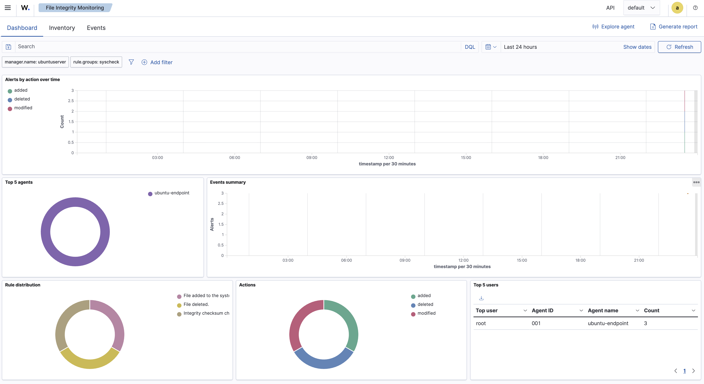
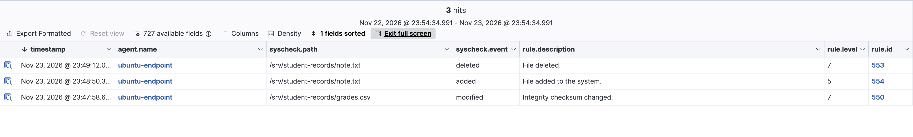

# Incident 03: Tampering with student records on ubuntu-endpoint

| | |
|---|---|
| **Date** | November 23, 2026 |
| **Host** | `ubuntu-endpoint` (agent 001, 192.168.64.101) |
| **Detected by** | Wazuh File Integrity Monitoring (syscheck), real-time mode |
| **Severity** | Medium as rated by Wazuh (level 5 to 7). I'd treat it as high because of the data involved. |
| **Verdict** | True positive (lab simulation I ran) |
| **Analyst** | Ulises Estrella |

## Summary

On November 23, 2026, Wazuh raised three File Integrity Monitoring alerts on ubuntu-endpoint, all in `/srv/student-records` and all within about 74 seconds. A student's grade in `grades.csv` was changed from A to F, then a file called `note.txt` was added to the same folder and deleted 22 seconds later. Writing to this folder requires root, so whoever did this had elevated access. The alerts don't show who it was.

## Detection

Wazuh's agent on ubuntu-endpoint watches `/srv/student-records` in real time. Three rules fired:

| Time (PST) | File | Action | Rule | Level |
|---|---|---|---|---|
| 11:47:58 PM | `/srv/student-records/grades.csv` | modified | 550, Integrity checksum changed | 7 |
| 11:48:50 PM | `/srv/student-records/note.txt` | added | 554, File added to the system | 5 |
| 11:49:12 PM | `/srv/student-records/note.txt` | deleted | 553, File deleted | 7 |

Wazuh's built-in FIM report for the last 24 hours (`manager.name: ubuntuserver AND rule.groups: syscheck`) matches: these three rules are the only FIM rules that fired, ubuntu-endpoint is the only agent with FIM alerts at level 7 or above, and its alerts summary lists one modify, one add and one delete, all in `/srv/student-records`.

## Triage

What I checked to confirm the alerts were real and not noise:

- **Scope.** All three alerts are on one host and in one folder. No other agent had FIM activity in the same window.
- **The change itself.** The rule 550 event includes a diff (`syscheck.diff`) because the folder is monitored with `report_changes`. It shows the line `Grade: A` replaced by `Grade: F`.
- **Ownership.** The FIM dashboard lists `root` as the user for all three events. That's the file owner after the change (`uname_after`), not proof of who made the change.
- **Timing.** Three events in under 75 seconds, in a folder that normally doesn't change, is not routine activity.

## Analysis

The order of events tells the story. First, an existing record was altered: a student's grade went from A to F, which is the most damaging part, since nothing looks broken afterward. Less than a minute later, a new file appeared in the same folder, and 22 seconds after that it was gone. Adding a file and quickly deleting it is consistent with someone dropping a tool or note and then cleaning up after themselves.

Taken together, this is one incident, not three separate alerts. An analyst who closed each alert on its own could miss that a grade was changed and the evidence partly cleaned up.

**What these alerts can't tell me:** who made the changes, and how they got root access. FIM in real-time mode records what changed and when, but not which user or process did it. Answering that would take the system's auth logs (`/var/log/auth.log`), sudo history, and ideally FIM with `whodata` turned on (see Tuning).

## Verdict

**True positive.** This was a simulated attack I ran myself to test detection. All three actions were caught within seconds, with the exact files and the content of the change.

## MITRE ATT&CK

| Technique | Why it fits |
|---|---|
| [T1565.001, Data Manipulation: Stored Data Manipulation](https://attack.mitre.org/techniques/T1565/001/) | A stored record (the grade) was altered to change its meaning |
| [T1070.004, Indicator Removal: File Deletion](https://attack.mitre.org/techniques/T1070/004/) | The dropped file was deleted shortly after it was created, consistent with covering tracks |

Wazuh's default rules 550, 553 and 554 don't carry MITRE tags, so I mapped these myself.

## Response (if this were real)

1. **Contain.** Find out which accounts had root access around 11:47 PM and disable or reset them. If the server can't be trusted, isolate it from the network.
2. **Investigate.** Review `/var/log/auth.log` and sudo logs for logins and privilege use before 11:47 PM. Check other hosts for logins from the same account or source IP. Look for other files changed on the server in the same window.
3. **Recover.** Restore `grades.csv` from the last known-good backup and confirm the restored grade with the records owner.
4. **Notify.** Tell my supervisor and the owner of the student records. Because student data was altered, follow the district's incident response plan, including any reporting it requires.

## Tuning

- **Turn on `whodata`.** Switching the monitored folder from `realtime="yes"` to `whodata="yes"` uses the Linux audit system (`auditd`) to record the user and process behind each change. That would have answered "who" in this incident.
- **Raise the alert level for this folder.** Wazuh rates these changes at 5 to 7 (medium). For a folder of student records, any change should be level 10 or higher so it can't get buried in routine alerts. A custom rule that matches on `/srv/student-records` would do this.
- **Treat add-then-delete as a pattern.** A correlation rule that fires when a file is added and deleted in a sensitive folder within a few minutes would flag possible cleanup directly.

## Evidence

- Wazuh FIM report (PDF): [wazuh-fim-report.pdf](evidence/03-student-records/wazuh-fim-report.pdf)
- FIM dashboard: all three actions on ubuntu-endpoint

  

- FIM events table: timestamps, paths, rule IDs and levels

  

- Diff of `grades.csv` (A to F): *screenshot to be added*

## How the attack was simulated

For anyone repeating this in their own lab. Fake data only.

```bash
# Create the fake records folder and file
sudo mkdir -p /srv/student-records
echo 'Student: Test Person, ID 000001, Grade: A' | sudo tee /srv/student-records/grades.csv

# Watch the folder: add this line inside <syscheck> in /var/ossec/etc/ossec.conf, then restart the agent
# <directories realtime="yes" check_all="yes" report_changes="yes">/srv/student-records</directories>
sudo systemctl restart wazuh-agent

# The tampering
echo 'Student: Test Person, ID 000001, Grade: F' | sudo tee /srv/student-records/grades.csv   # modify
echo 'dropped by attacker' | sudo tee /srv/student-records/note.txt                           # add
sudo rm /srv/student-records/note.txt                                                         # delete
```

*Note on times: the alert times above are Pacific (PST), as shown in the dashboard. The agent registration and keep-alive times in the Wazuh PDF are in UTC.*
